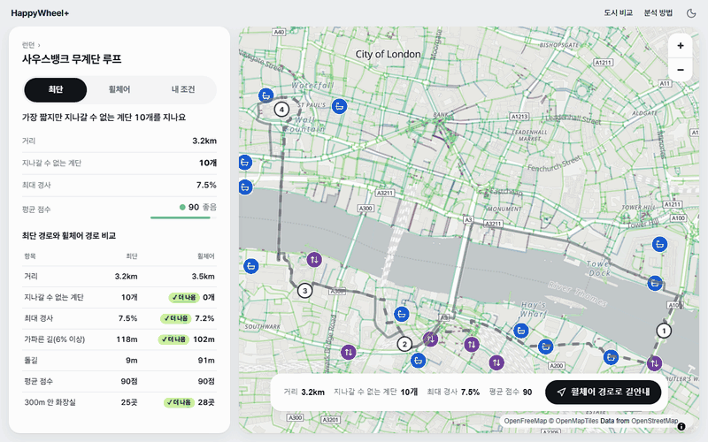
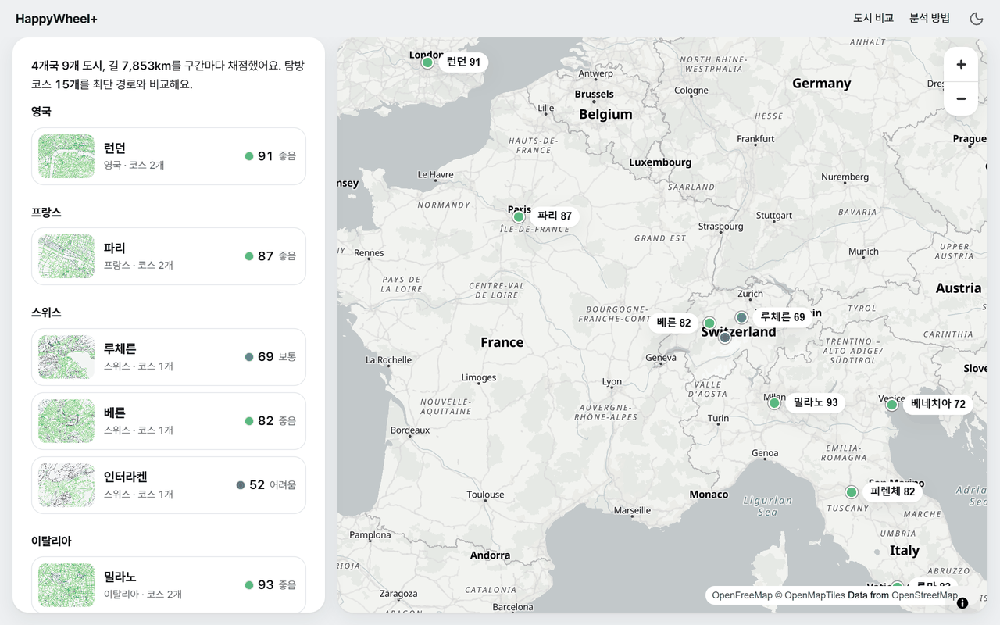
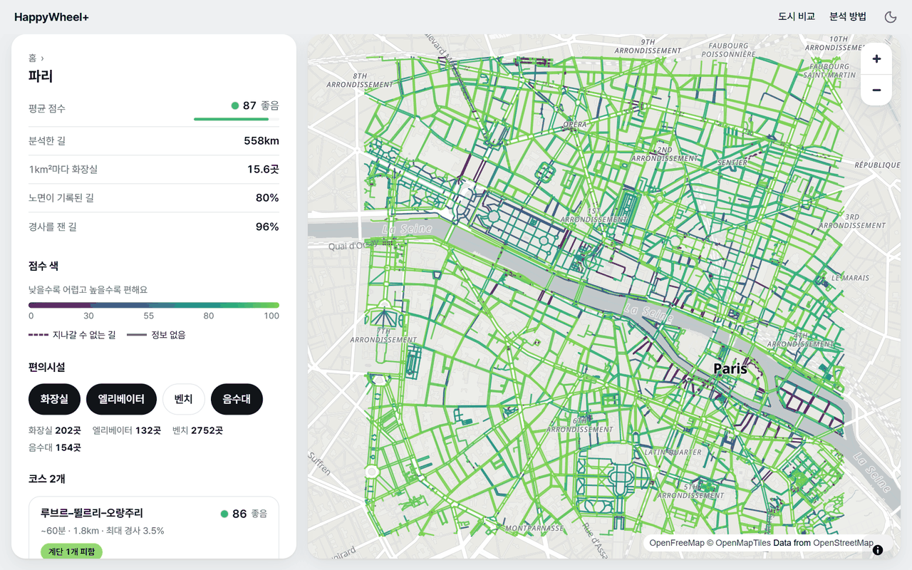
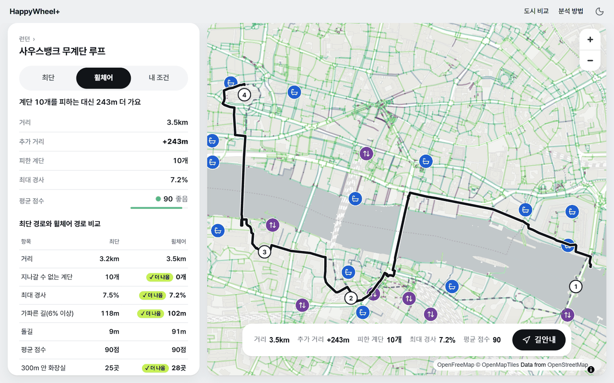
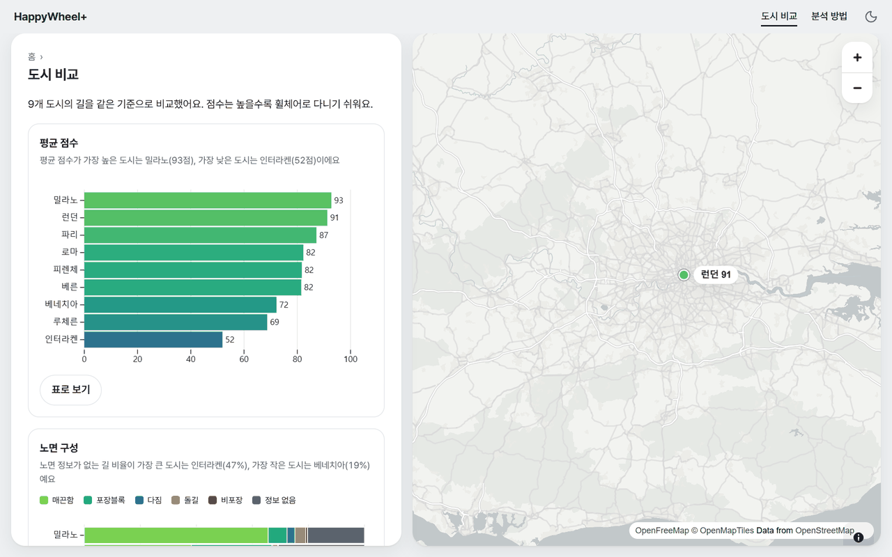
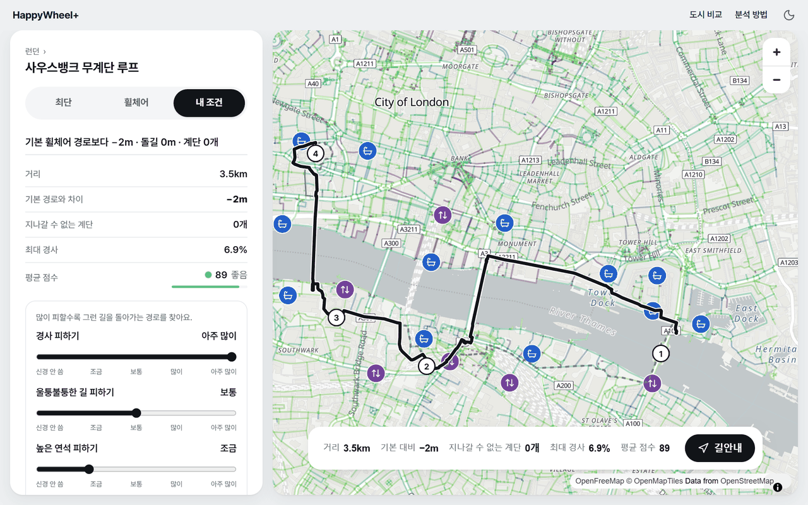
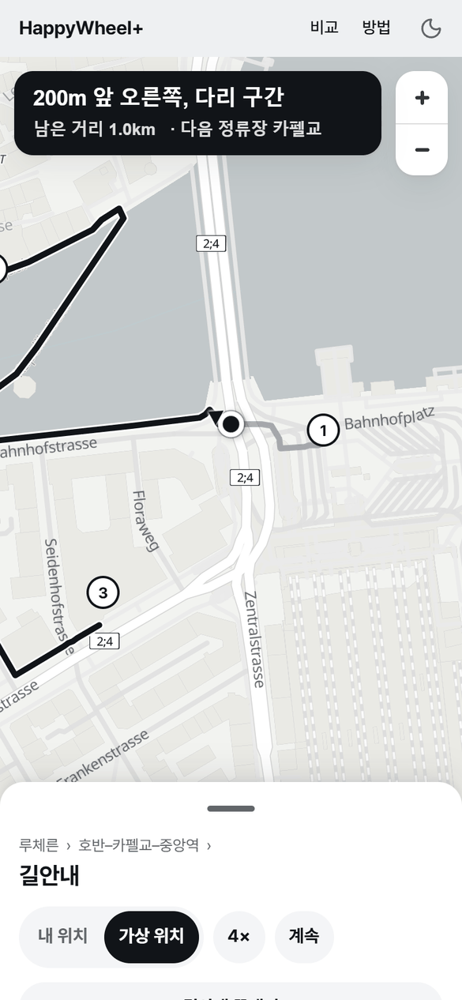
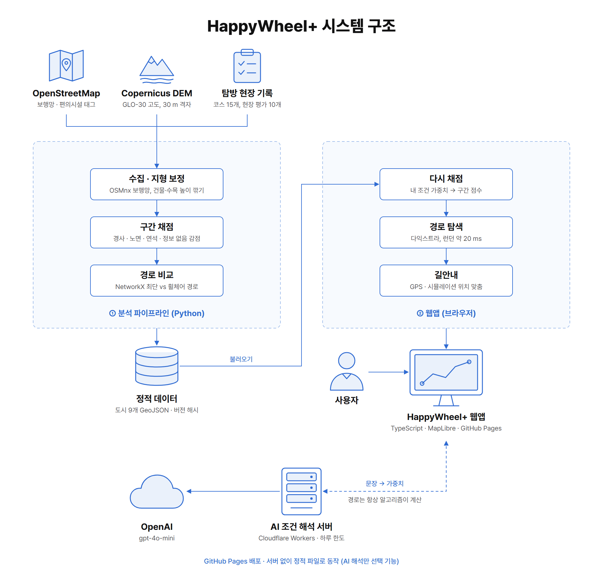
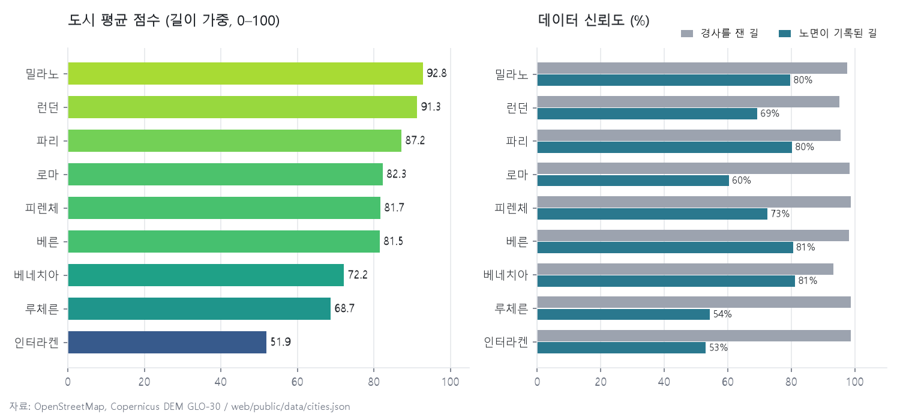

<div align="center">

# HappyWheel+

**휠체어 여행자를 위해 유럽 9개 도시의 길을 점수로 보여 주고, 계단 없는 경로를 안내하는 서비스**

2025 동계 해외문화탐방 8조 프로젝트를 데이터 분석 중심으로 리디자인한 프로젝트

[🔗 데모 바로가기](https://yejineeeee.github.io/HappyWheelPlus/) | [📄 탐방 발표자료 (PDF)](docs/field-trip-2026-01-27.pdf) | [📓 분석 노트북](pipeline/notebooks/methodology.ipynb)



&nbsp;&nbsp;&nbsp;&nbsp;&nbsp;&nbsp;&nbsp;&nbsp;&nbsp;&nbsp;

</div>

<br>

## 📌 프로젝트 개요

| 항목 | 내용 |
|---|---|
| 기간 | 원 프로젝트 2025.12.26 \~ 2026.01.06 (동계 해외문화탐방) / 리디자인 2026.11 |
| 인원 | 원 프로젝트 2인 팀 / 리디자인 개인 |
| 범위 | 4개국 9개 도시 (런던, 파리, 루체른, 베른, 인터라켄, 밀라노, 베네치아, 피렌체, 로마), 탐방 코스 15개 |
| 배포 | GitHub Pages (웹앱) + Cloudflare Workers (AI 조건 해석 서버) |

동계 해외문화탐방에서 '휠체어 이용자의 유럽 여행'을 주제로 4개국 9개 도시를 다녔다.    
직접 다녀 보니 관광지 자체보다 관광지 사이를 오가는 길이 더 문제였다.     
계단으로만 건널 수 있는 다리도 있었고, 돌길 광장이나 짧은데 경사가 심한 언덕도 자주 나왔다. 그런데 일반 지도 앱에서는 이런 길이 다른 길과 똑같이 표시된다.    

탐방 때도 코스마다 난이도와 메모를 남겼지만, 처음 만든 앱에서는 그 난이도를 우리가 느낀 대로 직접 적어 넣었다. 그러나 리디자인을 하면서, 같은 판단을 데이터를 통해 해 보고 싶었다.

OpenStreetMap 보행망 약 28만 구간(약 7,853 km)을 경사, 노면, 연석, 정보 부족 기준으로 채점했고, 코스마다 최단 경로와 휠체어 경로를 같이 계산했다.    
휠체어 경로가 무엇을 피하느라 얼마나 더 돌아가는지 한눈에 비교할 수 있게 하는 게 목표였고,    
조건 가중치를 바꾸면 브라우저에서 바로 경로를 다시 찾고, 따로 설정하지 않아도 링크만 열면 주요 기능을 다 쓸 수 있다.    

<br>

## ✨ 주요 기능

| 단계 | 질문 | 방법 | 결과 |
|---|---|---|---|
| 데이터 수집, 채점 | 이 길은 휠체어로 다니기 쉬운가 | OSM 태그와 보정한 고도로 길마다 감점 4가지를 매겨 0\~100점으로 채점 | 도시별 점수 히트맵 |
| 경로 비교 | 계단을 피하면 얼마나 돌아가는가 | 같은 정류장 사이에서 최단 경로와 휠체어 경로(점수가 낮은 길일수록 비용을 높게 잡음)를 각각 계산 | 거리, 피한 계단, 최대 경사, 돌길 길이 비교 표와 경사 단면 |
| 내 조건 재계산 | 나는 경사보다 돌길이 더 힘들다면 | 슬라이더로 가중치를 바꾸면 브라우저에서 점수와 경로를 바로 다시 계산 | 기본 휠체어 경로와 내 경로 비교 |
| 길안내 | 지금 어디서 어느 쪽으로 가야 하나 | 경로 위 내 위치를 찾고, 방향이나 길 상태가 바뀌는 지점마다 안내 문구를 만듦 (외부 길찾기 API 없이) | "200m 앞 오른쪽, 다리 구간" 같은 안내, 가상 위치로 시연 |
| 도시 비교 | 어느 도시가 다니기 쉬운가 | 평균 점수, 노면 구성, 편의시설 밀도, 데이터 신뢰도를 같은 기준으로 비교 | 그래프 4종 |

### 화면 구성

| 홈 | 도시 점수 히트맵 |
|:---:|:---:|
|  |  |
| 나라별로 도시를 묶고, 도시마다 평균 점수와 작은 히트맵을 보여 준다 | 파리의 길을 점수에 따라 색칠하고, 지나갈 수 없는 길은 빨간 점선으로 표시했다 |
| **코스 비교** | **도시 비교** |
|  |  |
| 런던 사우스뱅크 코스는 계단 10개를 피하는 대신 243 m를 더 돌아간다 | 9개 도시를 평균 점수, 노면 구성, 편의시설, 데이터 신뢰도로 비교한다 |

<details>
<summary><b>내 조건 재계산과 모바일 길안내 보기</b></summary>

<br>

| 내 조건 | 모바일 길안내 |
|:---:|:---:|
|  |  |
| 경사 피하기를 "아주 많이"로 올리면, 최대 경사가 7.2%에서 6.9%로 낮은 경로를 다시 찾는다 | 루체른 코스를 가상 위치로 따라가면서 다음 안내, 남은 거리, 다음 정류장을 보여 준다 |

문장으로 조건을 적으면(예: "경사가 힘들어요") AI 서버가 가중치로 바꿔 주는 입력창도 있다.     
     

</details>

<br>

## 🏗 시스템 구조

<p align="center"></p>

파이프라인이 도시마다 정적 파일을 만들어 두고, 웹앱은 서버 없이 이 파일만 읽어서 동작한다. 경로 계산용 그래프도 브라우저가 직접 갖고 있어서, 가중치를 바꿔도 서버를 거치지 않고 바로 경로를 다시 찾는다.

| 파일 (`web/public/data/<도시>/`) | 내용 |
|---|---|
| `segments.geojson` | 구간 선, 항목별 감점, 점수, 계단·다리 여부 |
| `graph.json` | 브라우저 경로 계산용 경량 그래프 (노드 좌표·고도, 간선 감점) |
| `courses.json` | 코스별 최단·휠체어 경로 좌표, 비교 지표, 25 m 간격 경사 단면, 현장 기록 |
| `pois.geojson` | 화장실, 엘리베이터, 벤치, 음수대 |
| `cities.json` (상위) | 도시 색인, 요약 지표, 파일 내용 해시(`data_version`) |

### 기술 스택

| 구분 | 사용 기술 |
|---|---|
| 데이터 수집 | OSMnx (OpenStreetMap 보행망·편의시설), rasterio (Copernicus DEM) |
| 공간 분석 | GeoPandas, Shapely, pyproj, SciPy (지형 보정), NetworkX (경로) |
| 분석 문서 | Jupyter, matplotlib |
| 웹앱 | TypeScript, Vite, MapLibre GL JS, OpenFreeMap 타일, Observable Plot, vite-plugin-pwa |
| AI 조건 해석 | Cloudflare Workers, Workers KV (하루 호출 한도), OpenAI API (gpt-4o-mini) |
| 테스트 | pytest, Vitest, Playwright |
| 배포 | GitHub Actions → GitHub Pages (테스트를 모두 통과해야 배포) |

<br>

## 📊 분석 결과

### 구간 점수 모델

```
구간 점수 = 100 − Σ (가중치 × 감점)        감점 4종: 경사, 노면, 연석, 불확실성 (각 0~100)
경로 비용 = 길이 × (1 + 3 × (100 − 점수) / 100)
```

| 항목 | 감점 규칙 | 기본 가중치 |
|---|---|---|
| 경사 | 최대 경사 5% 미만 0 → 5\~8.33%에서 0→50 → 8.33\~12%에서 50→100 → 12% 이상 100. 8.33%는 ADA 경사로 기준(1:12) | 1.0 |
| 노면 | 매끈함 0 / 포장블록 20 / 다짐·잔자갈 40 / 돌길(sett·cobblestone) 70 / 비포장 90. 노면 상태 bad 이하면 +20 | 0.8 |
| 연석 | 횡단 지점 `kerb=raised` 60, 낮춘 연석·정보 없음 0 | 0.6 |
| 불확실성 | 노면 정보 없음 +15, 경사 정보 없음 +15 | 0.3 |
| 통과 불가 | 계단(경사로·휠체어 가능 표기가 있으면 제외), `wheelchair=no`. 휠체어 경로에서 뺀다 | – |
| 보너스 | `wheelchair=yes`이면 최종 점수 +10 (최대 100) | – |

정보가 없는 길이 좋은 길로 취급되지 않도록 불확실성 감점을 따로 넣었다. 그리고 최종 점수만 저장하지 않고 항목별 감점도 같이 저장해 둬서, 웹에서 가중치를 바꾸면 점수를 바로 다시 계산할 수 있다.

### 도시별 결과

<p align="center"></p>

| 도시 | 평균 점수 | 분석한 길 | 노면 기록 비율 | 경사 측정 비율 | 1㎢당 화장실 |
|---|---:|---:|---:|---:|---:|
| 밀라노 | 92.8 | 1,334 km | 79.7% | 97.7% | 2.5 |
| 런던 | 91.3 | 1,120 km | 69.3% | 95.1% | 4.8 |
| 파리 | 87.2 | 558 km | 80.2% | 95.6% | 15.6 |
| 로마 | 82.3 | 1,357 km | 60.4% | 98.5% | 3.9 |
| 피렌체 | 81.7 | 955 km | 72.5% | 98.7% | 1.3 |
| 베른 | 81.5 | 1,054 km | 80.5% | 98.3% | 3.4 |
| 베네치아 | 72.2 | 201 km | 81.2% | 93.2% | 1.7 |
| 루체른 | 68.7 | 827 km | 54.3% | 98.8% | 1.9 |
| 인터라켄 | 51.9 | 448 km | 53.1% | 98.8% | 0.9 |

평균 점수와 비율은 모두 길이를 기준으로 계산했다.
경사는 모든 도시에서 93% 넘게 계산됐지만, 노면 태그는 도시마다 차이가 컸다. 점수가 가장 낮은 인터라켄과 루체른은 노면을 모르는 길이 거의 절반이라 불확실성 감점을 많이 받았고, 반경 3 km 안에 산비탈 길도 들어 있다. 그래서 점수가 낮은 이유가 지형 때문인지, 태그가 부족해서인지는 이 분석만으로는 구분하기 어렵다.

### 사례: 최단 경로 vs 휠체어 경로

| 코스 | 최단 경로 | 휠체어 경로 | 해석 |
|---|---|---|---|
| 런던 사우스뱅크 무계단 루프 | 3,238.5 m, 계단 10곳 | 3,481.0 m, 계단 0곳 | 242.5 m(약 7.5%)를 더 돌아가는 대신 계단을 모두 피한다. 다만 돌길이 8.5 m에서 91.2 m로 늘어서, 계단을 피하려면 거친 길을 어느 정도 감수해야 한다 |
| 베네치아 리알토–산 폴로 | 355.2 m, 계단 5곳 | 624.6 m, 계단 0곳 | 운하를 건너는 다리 대부분이 계단이라 휠체어로 갈 수 있는 길이 군데군데 끊겨 있다. 정류장이 최대 325 m 떨어진 곳에 붙어서 근사 결과로 표시했다 |
| 로마 포로 로마노 주변 산책 | 874.0 m, 돌길 784.6 m | 1,039.4 m, 돌길 401.9 m | 돌길이 절반 정도로 줄지만 여전히 경로의 40% 가까이가 돌길이고, 최대 경사도 둘 다 12.0%다. 다른 길이 없으면 경로를 바꿔도 피할 수 없다는 걸 보여 준다 |
| 루체른 호반–카펠교–중앙역 | 948.6 m, 계단 4곳 | 1,123.3 m, 계단 0곳 | 174.7 m를 더 돌아간다. 카펠교처럼 계단 구간이어도 경사로나 휠체어 가능 표시가 있으면 지나갈 수 있는 길로 봤다. 실제 현장 기록도 "리프트가 있어 혼자 이동 가능"(난이도 1)이었다 |

<details>
<summary><b>15개 코스 전체 비교</b></summary>

<br>

| 도시 | 코스 | 최단 (m) | 휠체어 (m) | 추가 (m) | 피한 계단 | 돌길 최단/휠체어 (m) | 경로 점수 최단/휠체어 |
|---|---|---:|---:|---:|---:|---:|---:|
| 런던 | 사우스뱅크 무계단 루프 | 3,238.5 | 3,481.0 | 242.5 | 10 | 8.5 / 91.2 | 90.1 / 90.0 |
| 런던 | 웨스트민스터–세인트 제임스–트라팔가 | 1,555.0 | 1,579.1 | 24.1 | 1 | 0.0 / 6.9 | 92.7 / 94.0 |
| 파리 | 루브르–뛸르리–오랑주리 | 1,400.0 | 1,764.9 | 364.9 | 1 | 161.8 / 161.5 | 56.8 / 85.8 |
| 파리 | 노트르담–시테섬–퐁네프 | 1,134.2 | 1,517.2 | 383.0 | 5 | 474.4 / 134.2 | 68.8 / 89.3 |
| 루체른 | 호반–카펠교–중앙역 | 948.6 | 1,123.3 | 174.7 | 4 | 193.2 / 189.5 | 86.1 / 88.9 |
| 베른 | 아르강 전망–분수–연방의사당 | 722.6 | 745.6 | 23.0 | 0 | 191.7 / 33.6 | 83.0 / 96.0 |
| 인터라켄 | 회퍼브루케–호헤마트 공원 | 745.1 | 805.1 | 60.0 | 0 | 0.0 / 12.9 | 87.3 / 98.8 |
| 밀라노 | 두오모–갤러리아 | 489.5 | 516.9 | 27.4 | 0 | 0.0 / 0.0 | 87.3 / 91.4 |
| 밀라노 | 스포르체스코 성–브레라 | 823.0 | 874.8 | 51.8 | 0 | 164.7 / 0.0 | 77.2 / 90.8 |
| 베네치아 | 두칼레–산 마르코 | 176.5 | 232.5 | 56.0 | 0 | 155.0 / 65.6 | 36.3 / 72.7 |
| 베네치아 | 리알토–산 폴로 (근사) | 355.2 | 624.6 | 269.4 | 5 | 127.5 / 72.5 | 73.4 / 78.9 |
| 피렌체 | 두오모–시뇨리아 | 711.5 | 712.9 | 1.4 | 0 | 247.1 / 148.1 | 70.8 / 76.2 |
| 피렌체 | 우피치–베키오 다리–피티궁 | 809.2 | 839.5 | 30.3 | 0 | 426.6 / 138.3 | 56.0 / 75.3 |
| 로마 | 나보나–판테온 | 372.6 | 465.0 | 92.4 | 0 | 236.9 / 57.4 | 52.8 / 86.9 |
| 로마 | 포로 로마노 주변 산책 | 874.0 | 1,039.4 | 165.4 | 1 | 784.6 / 401.9 | 30.5 / 71.4 |

휠체어 경로가 항상 크게 달라지는 건 아니다. 피렌체 두오모–시뇨리아는 차이가 1.4 m뿐이라 사실상 같은 경로다.

</details>

<details>
<summary><b>탐방 현장 기록과 계산 점수 나란히 보기 (10개 코스)</b></summary>

<br>

| 코스 | 탐방팀 난이도 (1 쉬움 \~ 5 어려움) | 휠체어 경로 점수 |
|---|:---:|---:|
| 베른 아르강 전망–분수–연방의사당 | 1 | 96.0 |
| 루체른 호반–카펠교–중앙역 | 1 | 88.9 |
| 런던 웨스트민스터–세인트 제임스–트라팔가 | 2 | 94.0 |
| 파리 노트르담–시테섬–퐁네프 | 2 | 89.3 |
| 피렌체 우피치–베키오 다리–피티궁 | 2 | 75.3 |
| 런던 사우스뱅크 무계단 루프 | 3 | 90.0 |
| 밀라노 두오모–갤러리아 | 3 | 91.4 |
| 베네치아 두칼레–산 마르코 | 3 | 72.7 |
| 파리 루브르–뛸르리–오랑주리 | 4 | 85.8 |
| 로마 포로 로마노 주변 산책 | 5 | 71.4 |

현장 난이도에는 혼잡, 건물 내부, 수상버스 타고 내리기처럼 점수 모델에 없는 요소까지 들어 있다. 루브르는 길보다 박물관 안 인파가 더 힘들었고, 사우스뱅크는 관광객이 많아서 힘들었다. 코스가 10개뿐이고 한 번씩 주관적으로 남긴 기록이라, 상관계수 같은 통계적인 결론은 내리지 않았다.

</details>

<br>

## ✅ 검증

| 방법 | 결과 |
|---|---|
| 브라우저 vs 파이프라인 일치 | 같은 그래프를 브라우저에서 다시 계산해도 파이프라인과 결과가 같았다. 구간 점수 차이 최대 7×10⁻¹⁵, 루체른 휠체어 경로 길이 1,123.2 m vs 1,123.3 m(−0.009%), 런던 두 코스 3,481.1/3,481.0 m, 1,579.0/1,579.1 m |
| 지형 보정 효과 | 루체른 구간 최대 경사의 90백분위 20.0% → 8.4%, 12% 초과 구간 비율 22% → 5.2% (경사가 계산된 간선 개수 기준) |
| 길안내 위치 맞춤 | 루체른·런던 코스를 5 m 간격으로 따라가는 시뮬레이션. 오차 없는 위치에서 최대 오차 1 m 미만(루체른), ±15 m 무작위 오차를 넣어도 최대 오차 55 m 미만이고, 경로를 벗어났다고 잘못 판단한 경우는 없었다 |
| 자동 테스트 | 파이프라인 pytest 126개, 웹 Vitest 219개, AI 서버 Vitest 39개, Playwright 스모크 테스트 1개 (홈 → 코스 비교 → 내 조건 → 도시 비교 → 길안내 → 잘못된 주소) 모두 통과 |
| 데이터 크기 | 도시마다 gzip 2 MB 이하인지 검사 (`check-size`, 최대 1.72 MB) |

<br>

## 🔥 트러블슈팅

<details>
<summary><b>1. 고도 데이터에 건물과 나무 높이가 섞여 경사가 부풀려진 문제</b></summary>

- **문제**: 처음 루체른을 계산했더니 휠체어 경로에 41% 경사가 나왔다. 알고 보니 Copernicus GLO-30은 지형(DTM)이 아니라 건물과 나무 꼭대기 높이까지 담긴 표면 모델(DSM)이었다. 그래서 건물 옆 평지를 지나기만 해도 30 m 사이에 몇 미터씩 솟는 것처럼 계산됐다. 보정 전 루체른은 구간 최대 경사의 90백분위가 20.0%, 12%를 넘는 구간이 22%였다.
- **해결**: 고도 격자를 읽은 다음 회색조 열림(grey opening, 5픽셀 창)으로 좁게 솟은 부분을 깎고, 가우시안 평활(σ 1.5)로 계단처럼 끊기는 부분을 다듬었다. 표본은 최근접 대신 쌍선형 보간으로 뽑았다. 단계마다 값을 확인해 보니 쌍선형 보간만 했을 때는 90백분위가 13.0%였고, 세 단계를 다 거쳐야 평지 골목의 이상값이 없어졌다.
- **결과**: 90백분위는 8.4%, 12% 초과 구간은 5.2%로 줄었다. 다만 폭 150 m가 넘는 건물 단지나 다리 주변은 여전히 틀릴 수 있어서 한계에 적어 뒀다.

</details>

<details>
<summary><b>2. 런던 정류장이 막힌 계단과 지하 통로 섬에 붙어 경로가 끊긴 문제</b></summary>

- **문제**: 9개 도시를 처음 돌렸을 때 런던 두 코스에서 휠체어 경로가 아예 나오지 않았다. 확인해 보니 세인트 폴 근처 정류장은 계단으로만 이어진 노드에, 웨스트민스터 다리 정류장은 지하 통로로만 이뤄진 작은 섬(노드 93개)에 붙어 있었다. 정류장을 무조건 가장 가까운 노드에 붙인 게 원인이었다.
- **해결**: 계단처럼 지나갈 수 없는 구간을 뺀 보행망에서 가장 크게 이어진 덩어리(런던 노드 38,841개)를 찾고, 정류장을 그 안에서 가장 가까운 노드에 붙이도록 바꿨다. 최단 경로와 휠체어 경로가 같은 출발점에서 시작해야 비교가 공정하기 때문이다. 정류장과 붙은 노드 사이 거리도 같이 내보내서, 150 m가 넘으면 웹에 "위치 오차 있음"이 뜨게 했다.
- **결과**: 런던 두 코스 모두 경로가 이어졌고, 사우스뱅크 코스는 최단 경로에 있던 계단 10곳을 모두 피했다. 근사로 표시되는 코스는 베네치아 리알토–산 폴로(325 m) 하나만 남았다.

</details>

<details>
<summary><b>3. 도로망을 단순화하면서 연석 정보가 사라진 문제</b></summary>

- **문제**: 연석(`kerb`) 정보는 길 중간 노드에 붙어 있는데, OSMnx로 도로망을 단순화하면 중간 노드가 합쳐지면서 이 정보도 같이 사라졌다. 그래서 루체른에서 높은 연석 감점이 붙은 구간이 35개밖에 없었다.
- **해결**: 단순화하기 전 원본 그래프를 캐시에 저장해 두고, 불러올 때마다 `kerb` 태그가 있는 노드는 남기면서 단순화하게 했다. 계단, 노면, 휠체어 태그가 서로 다른 간선도 합치지 않도록 해서, 긴 보행로 전체에 계단 표시가 번지는 문제도 같이 막았다. 이렇게 하면 단순화 규칙을 바꿔도 데이터를 다시 받을 필요가 없다.
- **결과**: 높은 연석 감점이 붙은 구간이 루체른은 35개에서 181개로, 밀라노는 2,353개로 늘었다. 인터라켄은 원본 OSM에 `raised` 연석이 하나도 없어서, 0개가 맞는 값이라는 것도 확인했다.

</details>

<details>
<summary><b>4. 다리 위 경사 단면이 강바닥으로 꺼진 문제</b></summary>

- **문제**: 경로의 고도 단면을 그려 보니 다리를 건널 때마다 그래프가 아래로 푹 꺼졌다. 다리 위 지점이 다리 노면이 아니라 그 아래 강물 높이를 읽고 있었다.
- **해결**: 다리와 터널 간선은 고도 격자를 읽지 않고, 양 끝 노드 고도를 직선으로 이어서 채웠다. 다리 중간에 있는 노드는 다리 밖에서 가장 가까운 두 노드 고도를 거리 비율로 섞었다. 웹에서 경로를 다시 계산할 때도 같은 규칙을 쓰도록 간선에 다리, 터널 표시를 넣었다.
- **결과**: 이제 다리 위 단면이 양 끝 높이를 따라 자연스럽게 이어진다. 첫 수정 뒤에도 밀레니엄 브리지 중간 노드에 0.7\~1.8 m 꺼짐이 남아 있었는데 이것까지 없앴고, 파이프라인과 브라우저의 단면도 같아졌다.

</details>

<details>
<summary><b>5. 왕복 코스에서 길안내 위치가 뒤로 가다 멈춘 문제</b></summary>

- **문제**: 루체른 코스에는 같은 길을 갔다가 되돌아오는 구간이 있다. 내 위치를 경로에서 가장 가까운 점에 맞추다 보니, 반환점을 지나 돌아오는 중에도 가는 길 쪽 점이 잡혔다. 그래서 진행 거리가 거꾸로 줄다가 멈췄고, 오차 없는 위치로 따라가도 최대 927 m가 어긋났다.
- **해결**: 직전 위치에서 실제로 움직인 거리와 경로 위에서 나아간 거리가 얼마나 맞는지도 같이 보고 점수를 매기도록 바꿨다. 후보는 직전 진행 거리 앞뒤로 움직인 거리와 GPS 정확도만큼만 찾고, 너무 많이 벗어나면 경로 전체에서 다시 찾는다.
- **결과**: 오차 없는 위치에서는 최대 오차가 0.37 m로 줄었고, 더 이상 뒤로 가지 않는다. ±15 m 오차를 넣은 시뮬레이션에서도 최대 오차는 55 m 미만이었다. 두 길이 16 m밖에 안 떨어진 급커브는 GPS만으로는 구분할 수 없어서 한계로 남겼다.

</details>

<details>
<summary><b>6. 큰 데이터 파일과 모바일 메모리 문제</b></summary>

- **문제**: 구간 파일이 도시당 최대 18 MB(밀라노)라서, 처음 반경 3 km로 만들었을 때 런던 2.18 MB, 파리 2.24 MB, 밀라노 2.02 MB로 gzip 기준 2 MB 한도를 넘었다. 여러 도시를 둘러보면 데이터가 메모리에 계속 쌓이는 문제도 있었다.
- **해결**: 반경은 "가장 먼 정류장 + 500 m"보다는 크게 유지하면서 줄였다(런던 2.7 km, 파리 1.8 km, 밀라노 2.7 km). 웹에서는 도시 데이터를 필요할 때만 불러오고, 메모리에는 최근 두 도시만 남긴다. 파일 내용 해시(`data_version`)를 캐시 키로 써서 데이터가 바뀌면 새로 받게 했다. 앱 화면 파일만 미리 저장해 두고, 데이터는 실제로 볼 때 저장한다.
- **결과**: 모든 도시가 gzip 2 MB 이하(가장 큰 런던이 1.72 MB)가 됐고, 한 번 본 도시 데이터는 서비스 워커 캐시에서 바로 다시 읽는다.

</details>

<br>

## 🗂 데이터

| 데이터 | 용도 | 출처·라이선스 |
|---|---|---|
| 보행 네트워크, 편의시설 | 구간, 노면·연석·계단·휠체어 태그, 화장실·엘리베이터·벤치·음수대 | © OpenStreetMap contributors, ODbL 1.0 |
| 고도 (GLO-30, 30 m) | 구간 경사, 경사 단면 | Copernicus DEM GLO-30. © DLR e.V. 2010-2014 and © Airbus Defence and Space GmbH 2014-2018 provided under COPERNICUS by the European Union and ESA; all rights reserved. |
| 배경 지도 | 웹 지도 타일 | OpenFreeMap, © OpenMapTiles, © OpenStreetMap contributors |
| 탐방 현장 기록 | 코스 15개의 정류장, 10개 코스의 난이도와 메모 | 2025 동계 해외문화탐방 8조 직접 기록 (`pipeline/config/cities.yaml`) |

<br>

## 📂 폴더 구조

```
HappyWheelPlus
├── pipeline/                 # 데이터 파이프라인 (Python) — 자세한 설명은 pipeline/README.md
│   ├── src/happywheel/       # 수집, 지형 보정, 채점, 경로, 내보내기, 썸네일
│   ├── config/cities.yaml    # 도시·코스·정류장·현장 기록
│   ├── notebooks/            # 분석 방법과 결과 노트북
│   └── tests/
├── web/                      # 웹앱 (TypeScript + Vite)
│   ├── src/core/             # 점수 재계산, 그래프, 다익스트라, 경사 단면
│   ├── src/nav/              # 위치 맞춤, 안내 문구, 가상 위치
│   ├── src/views/            # 홈, 도시, 코스, 내 조건, 길안내, 도시 비교
│   ├── public/data/          # 파이프라인 결과 (도시별 JSON·GeoJSON)
│   └── tests/, e2e/          # Vitest, Playwright
├── worker/                   # AI 조건 해석 서버 (Cloudflare Workers) — worker/README.md
├── docs/                     # 탐방 발표자료, 설계 문서, README 이미지
└── .github/workflows/        # 테스트 후 GitHub Pages 배포
```

<br>

## 🚀 실행 방법

**파이프라인** (Python 3.11 이상)

```bash
cd pipeline
python -m venv .venv
.venv/Scripts/python.exe -m pip install -e ".[dev]"   # macOS/Linux: .venv/bin/python

python -m happywheel run                 # 9개 도시 전체 (--city lucerne 처럼 골라서도 가능)
python -m happywheel check-size          # 도시별 gzip 크기 검사
python -m happywheel thumbs              # 홈 화면용 미니 히트맵
python -m pytest
```

OSM 데이터와 고도 타일은 처음 실행할 때 내려받아 `pipeline/.cache`에 저장되고, 결과 파일은 `web/public/data`에 만들어진다.

**웹앱** (Node.js 22)

```bash
cd web
npm ci
npm run dev        # 개발 서버
npm test           # 타입 검사 + Vitest
npm run build      # dist/ 빌드
npm run e2e        # Playwright 스모크 테스트 (처음 한 번 npx playwright install chromium)
```

**AI 조건 해석 서버**는 선택 기능이다. 배포 방법과 비용을 막는 장치(허용 Origin, IP당 하루 5회, 전체 하루 300회)는 [worker/README.md](worker/README.md)에 따로 정리했다. 서버 주소(`VITE_AI_ENDPOINT`)가 없으면 입력창만 숨겨지고 나머지 기능은 그대로 쓸 수 있다.

<br>

## ⚠️ 한계

- 경사는 30 m 격자 표면 모델을 보정해서 얻은 근사값이다. 짧은 급경사나 연석 턱은 평균에 묻히고, 다리나 큰 건물 단지 주변은 틀릴 수 있다.
- 점수는 어디까지나 "지도에 기록된 만큼의 접근성"이다. 노면 정보가 없는 길이 도시에 따라 19\~47%인데, 이런 길은 실제로 거칠 수 있다. 보도 폭, 횡단보도 신호, 혼잡, 공사 같은 요소는 모델에 넣지 못했다.
- 급커브에서 두 길이 30 m 안쪽으로 붙어 있으면, GPS 오차 때문에 길안내가 잠깐 옆 길로 잡힐 수 있다.
- 베네치아 리알토–산 폴로 코스는 정류장이 휠체어로 갈 수 있는 보행망에서 325 m 떨어진 곳에 붙어서 결과가 근사값이다.
- 건물 안 이동이나 지하철, 버스, 트램의 접근성은 다루지 않았다.
- 감점 값과 가중치는 ADA 경사 기준을 빼면 경험적으로 정했다. 현장 기록도 10개 코스뿐이라 통계적으로 보정하거나 검증하지는 못했다.
- AI 조건 해석은 문장을 가중치로 바꾸는 역할만 하고, 경로는 항상 같은 알고리즘이 계산한다.

<br>

## 📚 참고

- U.S. Department of Justice (2010). ADA Standards for Accessible Design, 405.2 Ramp Slope (1:12).
- Boeing, G. (2017). OSMnx: New Methods for Acquiring, Constructing, Analyzing, and Visualizing Complex Street Networks. Computers, Environment and Urban Systems, 65, 126–139.
- European Space Agency, Copernicus DEM — Global and European Digital Elevation Model (GLO-30).
- OpenMapTiles Vector Tile Schema, OpenFreeMap.
- MapLibre GL JS 문서.
- 2025 동계 해외문화탐방 8조 발표자료 ([PDF](docs/field-trip-2026-01-27.pdf)).
